# AWS Cloud Security Risk Assessment & GRC Simulation

A hands-on governance, risk, and compliance (GRC) assessment of a deliberately vulnerable AWS environment, performed end-to-end in the AWS console: build the weak environment, assess it against **NIST SP 800-53** and the **AWS Foundational Security Best Practices / CIS** benchmarks with **AWS Security Hub CSPM**, triage the findings, remediate, and document the result as a risk register, executive summary, and POA&M.

**Scenario:** I played a GRC analyst engaged by a fictional clinic, *Piedmont Family Clinic*, to assess its small AWS footprint (storage, a server, and user accounts) and report on its security posture. All data is synthetic — the "patient" file contains only fake records.

> **Note on redaction:** every screenshot has the 12-digit AWS account ID, sign-in URLs, access-key IDs, and personal details removed. This is a public repository and nothing sensitive is exposed.

---

## Contents

- [Executive summary](executive-summary.md) — one-page, non-technical overview
- [Plan of Action & Milestones (POA&M)](poam.md) — accepted findings and scheduled remediation
- [Risk register](risk-register.md) — full findings table with L×I scoring and NIST mappings
- `screenshots/` — evidence, before and after

---

## Tools & standards

- **AWS Security Hub (CSPM)** — automated posture assessment
- **IAM Access Analyzer** — public/external access detection
- **AWS CloudTrail** — audit logging
- **NIST SP 800-53 Rev. 5**, **NIST CSF 2.0**, **CIS AWS Foundations Benchmark**, **AWS FSBP**
- Services assessed: Amazon S3, EC2 & security groups, IAM, VPC

---

## Methodology

1. **Build** a deliberately misconfigured environment (the findings).
2. **Assess** with Security Hub CSPM, IAM Access Analyzer, and manual review.
3. **Triage** — separate planted findings and legitimate issues from baseline noise.
4. **Remediate** the in-scope findings; formally **accept** the rest with justification.
5. **Document** — risk register, remediation record, executive summary, POA&M.

---

## Baseline posture: 30%

The initial Security Hub CSPM evaluation scored **30%** — 18 controls passed, 42 failed, out of 77 total findings.

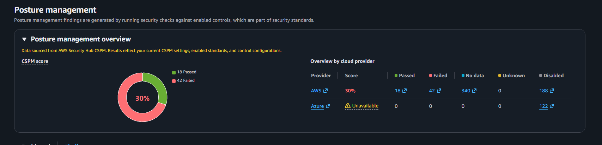

After triage, **ten findings** were relevant to the environment; the remainder were checks for services not in use (Amazon Inspector, GuardDuty) or default account settings outside the scenario's scope.

Critical and high-severity findings reviewed during triage:

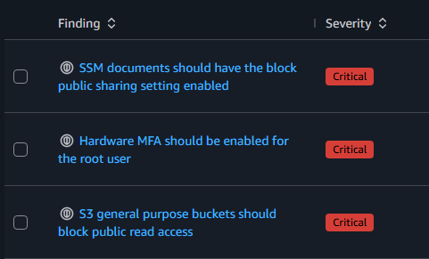
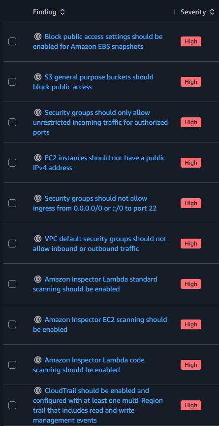

---

## Findings and remediation

### R-01 — Public S3 bucket exposing patient data *(Critical)*

The exports bucket had Block Public Access disabled and a bucket policy granting anonymous `s3:GetObject`.

**Before:**

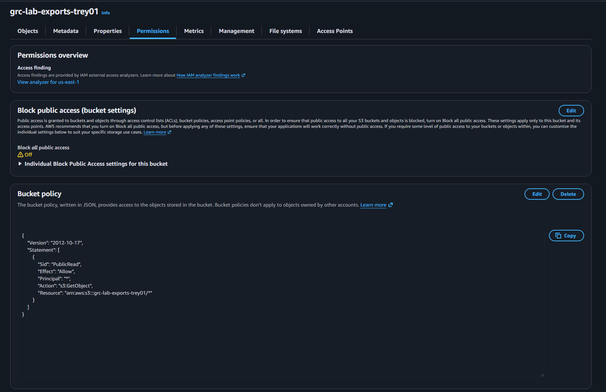

The object was downloadable from a private browser window with no authentication — confirming real exposure:

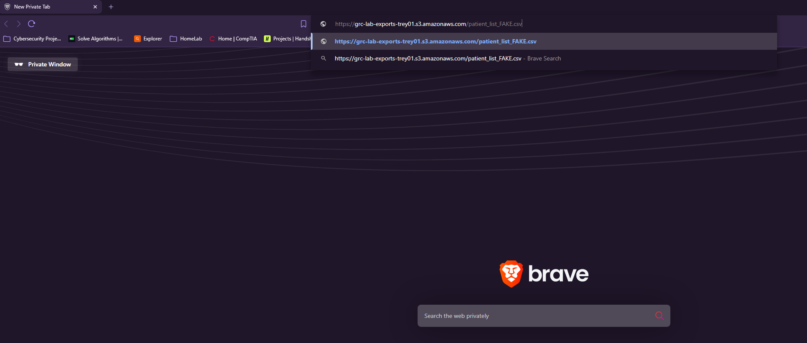
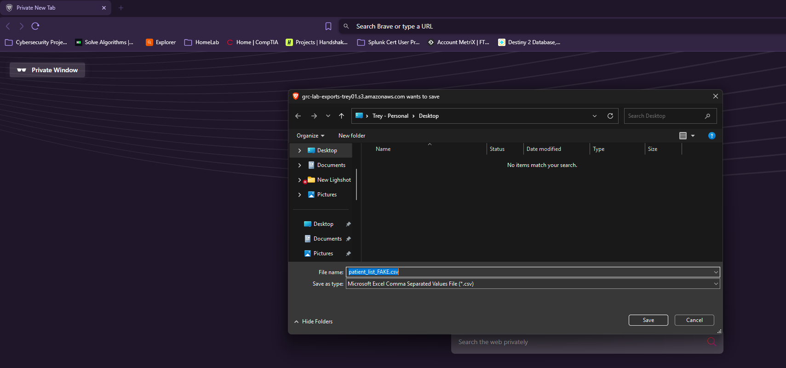

**Remediation:** re-enabled Block Public Access (all four settings) and deleted the public bucket policy.

**After:**

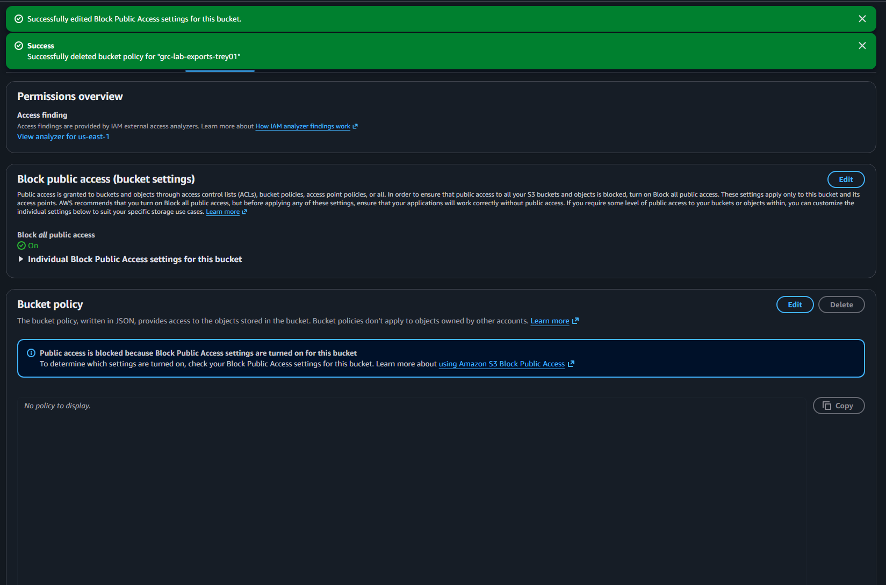

*NIST 800-53: AC-3, AC-21*

---

### R-02 — Security group open to the internet *(High)*

The instance's security group (`grc-lab-sg`) allowed SSH (22) and RDP (3389) from `0.0.0.0/0`.

**Before:**

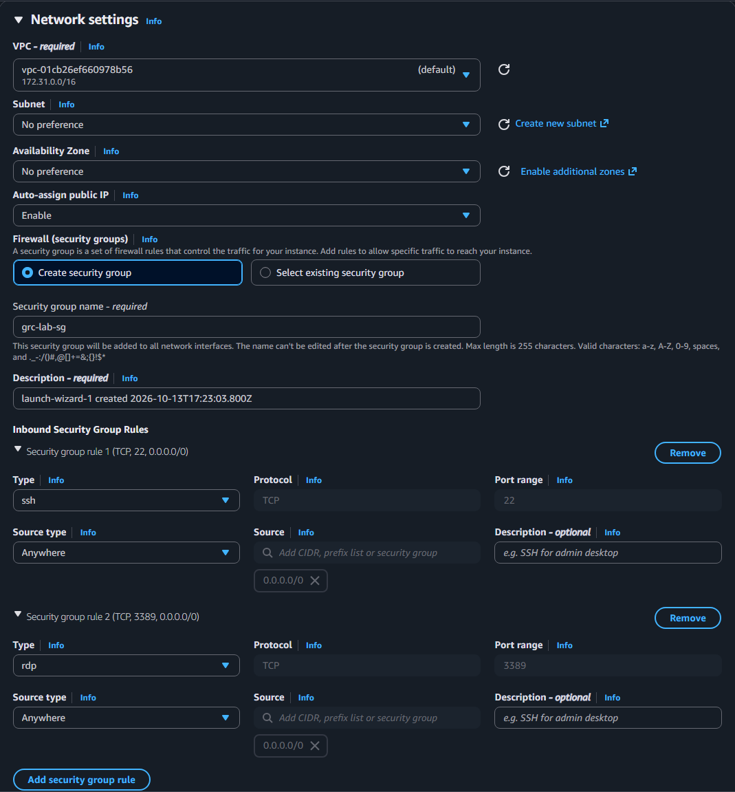

**Remediation:** removed the `0.0.0.0/0` inbound rules.

**After:**

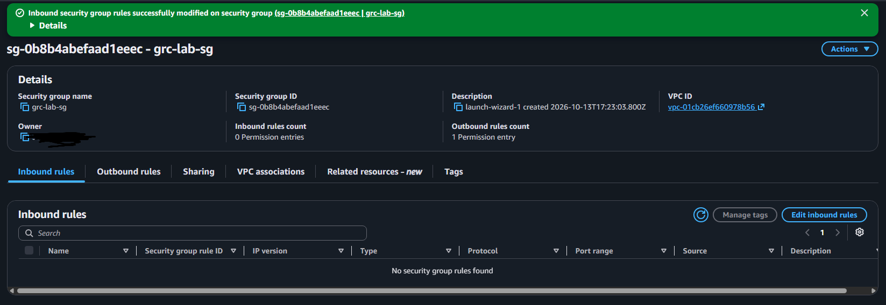

*NIST 800-53: SC-7, AC-17*

---

### R-03 / R-04 / R-07 — Over-privileged IAM user *(High)*

The `labadmin` user held `AdministratorAccess` directly, with a long-lived static access key and no MFA.

**Before:**

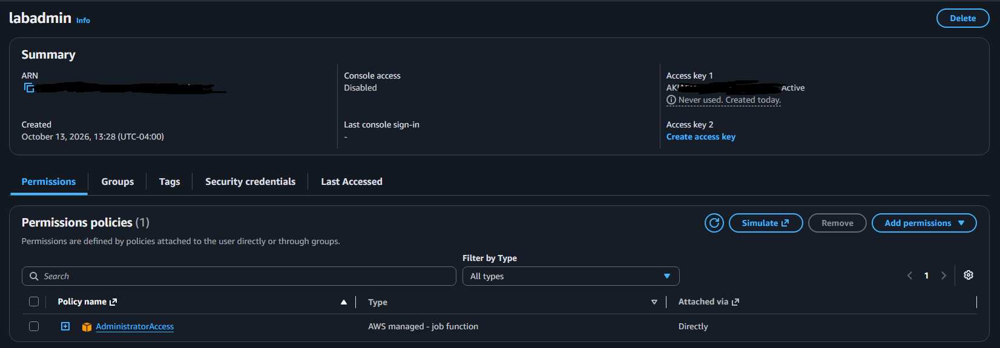
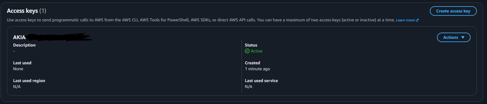

**Remediation:** detached `AdministratorAccess`, attached `ReadOnlyAccess` (least privilege), and deleted the static access key.

**After:**

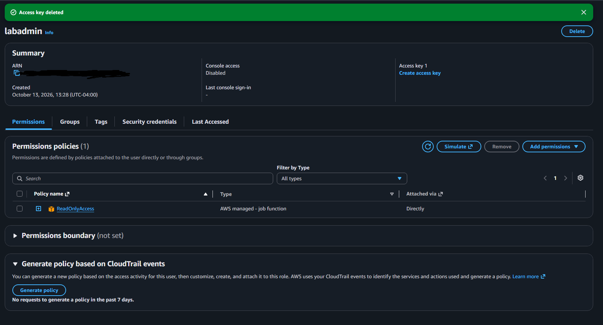

*NIST 800-53: AC-2, AC-6, IA-2, IA-5*

---

### R-05 — No audit logging *(High)*

No CloudTrail trail existed, so account activity was not recorded.

**Remediation:** created a multi-Region CloudTrail trail with management events and log file validation.

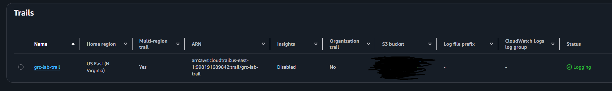

*NIST 800-53: AU-2, AU-6, AU-12*

---

### R-09 — Default VPC security group allows traffic *(High)*

The default security group permitted inbound and outbound traffic.

**Before:**

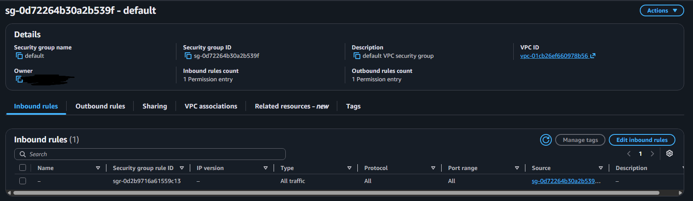
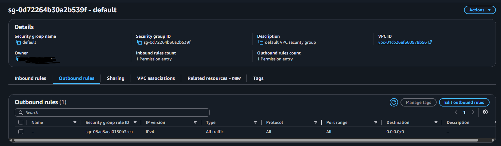

**Remediation:** removed all inbound and outbound rules from the default security group.

**After:**

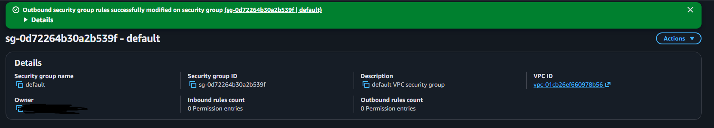

*NIST 800-53: SC-7*

---

## Accepted findings (documented, not remediated)

Not every finding warrants a fix. These were formally accepted with justification and tracked in the [POA&M](poam.md):

- **R-06 — No customer-managed KMS key.** S3 encrypts by default (SSE-S3); the residual gap is key rotation/access control. CMK recommended in production.
- **R-08 — Root uses virtual MFA, not hardware.** Acceptable for the lab; hardware key recommended in production.
- **R-10 — EBS snapshot public access not blocked.** No snapshots exist, so no exposure.
- **Out of scope:** Amazon Inspector and GuardDuty "enable this service" findings, and SSM document sharing — services not in use. Deliberately not enabled.

Knowing when *not* to spend effort — and documenting that decision — is itself a core GRC skill.

---

## Secure account setup

Before assessing, the account was brought to a baseline: a dedicated IAM admin user with MFA (root used only for account-level tasks), and a cost budget with alerts.

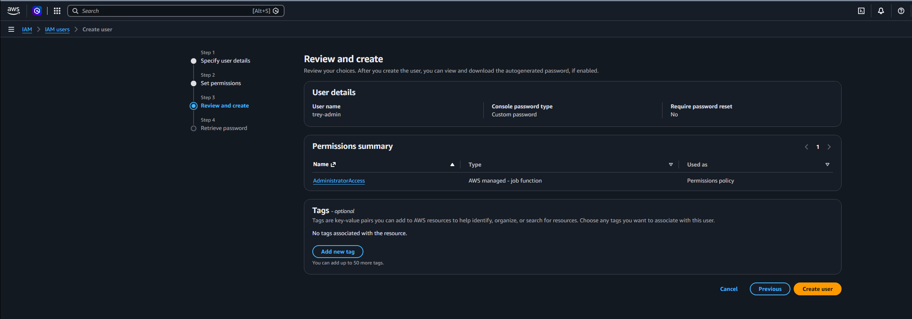
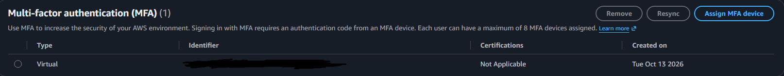
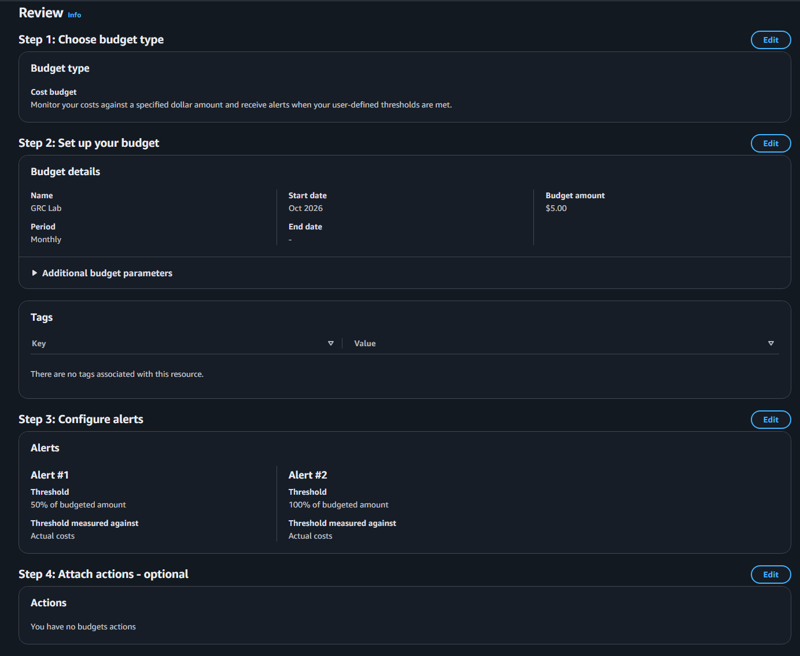

---

## Results

| | Before | After |
| --- | --- | --- |
| CSPM score | 30% | *pending re-evaluation* |
| Critical findings (relevant) | public S3 bucket | remediated |
| Public data exposure | yes | closed |
| Audit logging | none | multi-Region CloudTrail |
| Over-privileged IAM user | AdministratorAccess | ReadOnlyAccess |

Remediation was verified at the resource level in the console. Security Hub CSPM re-evaluates controls on its own schedule — S3, security-group, and VPC default-SG controls cleared within the hour; CloudTrail followed on the next pass. A raw CSPM score treats *accepted* risks as failures, so the gap between the final score and 100% is accounted for in the risk register and POA&M rather than being an open exposure.

---

## What I'd do differently in production

- Customer-managed KMS keys for sensitive data, with rotation
- Hardware MFA on root; IAM Identity Center instead of long-lived IAM users
- Infrastructure-as-code (Terraform/CloudFormation) so the baseline is enforced, not clicked
- Continuous monitoring with GuardDuty and automated remediation
